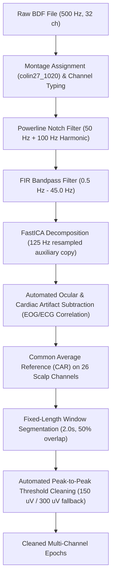

# Methodology: Pure EEG-Based ADHD Classification Prototype

This document outlines the complete methodology used in developing the cost-effective, electrophysiological (EEG-only) classification pipeline and prototype for Attention-Deficit/Hyperactivity Disorder (ADHD) using the **TDBRAIN (Two Decades of Brainclinics) V3.1** clinical dataset.

---

## 1. Study Design & Scientific Rationale

### 1.1 Motivation & Clinical Problem
ADHD diagnosis typically relies on subjective psychiatric evaluations, behavioral observer rating scales, and clinical interviews. While electroencephalography (EEG) has long demonstrated sensitivity to cortical hypoarousal (such as altered slow-wave activity), clinical adoption is often hindered by:
1. High acquisition and scoring costs.
2. Reliance on multimodal auxiliary batteries (e.g. specialized oddball reaction-time systems, extensive neuropsychological batteries).
3. Confounding variables that degrade real-world generalization.

### 1.2 The Cost-Effective Prototype Objective
The goal of this system is to develop a **pure EEG prediction pipeline** that requires **zero demographic inputs**, **zero behavioral/psychometric scores**, and **zero specialized stimulus delivery hardware**. Given a standardized resting-state EEG recording, the system performs automated signal conditioning, artifact rejection, spectral feature extraction, and instantaneous diagnostic classification ($<1\text{ ms}$ on standard CPU).

---

## 2. Dataset Architecture & Cohort Selection

### 2.1 Raw Data Characteristics (TDBRAIN V3.1)
The primary dataset consists of 1,300 clinical participants structured according to the Brain Imaging Data Structure (BIDS) standard:
- **Recording Hardware**: Neuroscan (Compumedics NuAmps).
- **Sampling Frequency**: $500\text{ Hz}$ continuous recording.
- **Electrode Layout**: 32 channels:
  - **26 Scalp EEG Electrodes (10–20 System)**:  
    `Fp1, Fp2, F7, F3, Fz, F4, F8, FC3, FCz, FC4, T7, C3, Cz, C4, T8, CP3, CPz, CP4, P7, P3, Pz, P4, P8, O1, Oz, O2`
  - **4 Dedicated Ocular (EOG) Channels**: `VPVA, VNVB` (vertical blinks) and `HPHL, HNHR` (horizontal saccades).
  - **1 Cardiac (ECG) Channel**: `Erbs`.
  - **1 Muscle (EMG) Channel**: `Mass` (masseter jaw activity).
- **Physical Reference**: Linked mastoids (`A1A2`).
- **Powerline Frequency**: $50\text{ Hz}$ (European electrical grid).

### 2.2 Task Selection
TDBRAIN includes three paradigms:
- `task-restEC`: Resting state, Eyes Closed (~2 minutes).
- `task-restEO`: Resting state, Eyes Open (~2 minutes).
- `task-oddball`: Auditory Oddball Event-Related Potential.

> [!IMPORTANT]
> **Dataset Finding**: Cross-referencing revealed that the ADHD cohort in TDBRAIN was **never administered the `task-oddball` paradigm** ($N=0$ ADHD participants). Consequently, the methodology centers on **resting-state EEG (`task-restEC`)**, which captures stable background neuro-oscillations.

### 2.3 The Developmental Age Confounder & Cohort Stratification
Initial demographic analysis of all participants revealed an acute sampling bias:
- **Full ADHD Group**: Ages 6.0 to 55.6 years (Mean = 23.1 years), with **49.5% ($N=101$) pediatric subjects ($<18$)**.
- **Healthy Control Group**: Ages 18.0 to 82.7 years (Mean = 40.3 years), with **0% pediatric subjects**.

Because pediatric EEG naturally exhibits higher low-frequency (delta/theta) power due to brain maturation, training an unconstrained model on the full cohort introduces severe age confounding (the model learns to classify age rather than ADHD neurophysiology).

**Cohort Stratification Protocol (Option A - Adult Sub-cohort)**:
- Inclusion Criterion: Age $\ge 18.0$ and Age $\le 60.0$ years.
- Final Curated Cohort: 220 adult subjects (74 ADHD, 146 Healthy Controls) for `task-restEC`.

---

## 3. Signal Preprocessing Pipeline

The signal conditioning pipeline is built upon MNE-Python and follows clinical neurophysiology guidelines:



### 3.1 Channel Typing & Montage Assignment
- The 26 scalp electrodes are assigned type `EEG` and registered to standard 10–20 spherical coordinates (`colin27_1020`).
- Auxiliary electrodes are tagged as `EOG`, `ECG`, and `EMG` for artifact tracking, while the trigger channel (`Status`) is isolated.

### 3.2 Filtering
1. **Notch Filter**: Zero-phase FIR notch at $50\text{ Hz}$ and the second harmonic ($100\text{ Hz}$) to eliminate line-frequency contamination.
2. **Bandpass Filter**: Zero-phase FIR bandpass between $0.5\text{ Hz}$ (suppressing DC baseline wander and sweat potentials) and $45.0\text{ Hz}$ (eliminating high-frequency electromyographic noise).

### 3.3 FastICA Artifact Correction via Auxiliary Channels
Rather than manual visual inspection, artifact removal is fully automated:
1. An auxiliary copy is downsampled to $125\text{ Hz}$ for fast, stable convergence.
2. FastICA decomposes the multichannel space into 15 independent components.
3. Automated Pearson correlation with the EOG channels (`VPVA, VNVB, HPHL, HNHR`) and ECG channel (`Erbs`) identifies ocular blinks, horizontal saccades, and cardiac QRS spikes.
4. The identified artifact components are zeroed out and projected back to the uncorrupted recording.

### 3.4 Spatial Re-referencing
Data are converted from the recording reference (linked mastoids) to **Common Average Reference (CAR)** across all 26 scalp electrodes:
$$V_i^{\text{CAR}} = V_i - \frac{1}{M}\sum_{k=1}^M V_k, \quad M = 26$$
CAR provides an unbiased reference frame essential for spatial power comparisons across lobes.

### 3.5 Epoch Segmentation & Outlier Rejection
- Continuous resting-state data (~120 seconds) are segmented into **2.0-second epochs with 50% overlap** (1.0-second step size), yielding ~115–119 epochs per participant ($1,001$ timepoints at $500\text{ Hz}$).
- Automated amplitude rejection discards any epoch where peak-to-peak amplitude exceeds $150\ \mu\text{V}$ (with an adaptive fallback to $300\ \mu\text{V}$ for high-amplitude subjects to prevent sample loss).

---

## 4. Electrophysiological Feature Engineering

From the cleaned epochs of each subject, **289 pure electrophysiological features** are extracted:

### 4.1 Power Spectral Density (PSD)
Welch’s method with Hann windowing is applied to each channel across the $0.5 - 45.0\text{ Hz}$ spectrum:
$$P(f) = \frac{1}{K}\sum_{k=1}^K |\mathcal{F}\{x_k(t)\}|^2$$

### 4.2 Canonical Spectral Band Powers
Numerical integration using Simpson's composite rule computes absolute power across the standard clinical EEG frequency bands:
- **Delta ($\delta$)**: $0.5 - 4.0\text{ Hz}$
- **Theta ($\theta$)**: $4.0 - 8.0\text{ Hz}$
- **Alpha ($\alpha$)**: $8.0 - 13.0\text{ Hz}$
- **Beta ($\beta$)**: $13.0 - 30.0\text{ Hz}$
- **Gamma ($\gamma$)**: $30.0 - 45.0\text{ Hz}$

**Relative Band Power**:
$$\text{RelPower}_{c, \text{band}} = \frac{\text{AbsPower}_{c, \text{band}}}{\sum_{\text{all bands}} \text{AbsPower}_{c, b}}$$
Calculated for all 26 scalp electrodes ($26 \times 5 = 130$ absolute $+ 130$ relative features).

### 4.3 Clinically Established ADHD Biomarkers
1. **Theta/Beta Ratio (TBR)**:
   $$\text{TBR}_c = \frac{\text{ThetaPower}_c}{\text{BetaPower}_c}$$
   Calculated across all 26 electrodes, specifically focusing on **Frontal Midline (`TBR_Fz`)** and **Central Midline (`TBR_Cz`)**, the primary neurofeedback and research biomarkers for ADHD cortical hypoarousal.
2. **Frontal Alpha Asymmetry (FAA)**:
   $$\text{FAA} = \ln(\text{Alpha}_{F4}) - \ln(\text{Alpha}_{F3})$$
   Quantifies hemispheric frontal activation imbalances related to executive function and affective dysregulation.

---

## 5. Machine Learning Classification & Cross-Validation

### 5.1 Zero-Leakage Validation Scheme
To ensure rigorous evaluation:
- **5-Fold Stratified Cross-Validation (`StratifiedKFold`)** balances the ADHD vs. Healthy ratio across folds.
- **Strict Subject Separation**: Preprocessing and feature extraction are aggregated per subject, ensuring zero data leakage across folds.
- **Standardization Inside Folds**: Feature scaling (z-score normalization) parameters are fitted strictly on the training folds and applied to test folds:
  $$z = \frac{x - \mu_{\text{train}}}{\sigma_{\text{train}}}$$

### 5.2 Model Architectures Evaluated
1. **Ridge Linear Classifier (Closed-Form $L_2$)**:
   $$\mathbf{w} = (\mathbf{X}^T\mathbf{X} + \alpha \mathbf{I})^{-1}\mathbf{X}^T\mathbf{y}$$
   Analytical, deterministic solution well-suited for high-dimensional feature spaces ($D=289, N=220$).
2. **$L_2$-Regularized Logistic Regression**:
   Trained via gradient descent with cross-entropy loss and weight decay regularization.
3. **Random Forest Classifier**:
   Ensemble of random decision trees capturing non-linear spectral interactions.
4. **K-Nearest Neighbors ($k=7$)**:
   Non-parametric distance-based benchmark in standardized spectral space.

### 5.3 Cross-Validation Performance Benchmarks

| Model | 5-Fold CV Accuracy | ROC-AUC | Specificity | Sensitivity (Recall) | F1-Score |
| :--- | :---: | :---: | :---: | :---: | :---: |
| **Ridge Linear Classifier ($L_2$)** | **0.669 ± 0.065** | **0.693 ± 0.077** | **0.815 ± 0.045** | **0.381 ± 0.147** | **0.427 ± 0.139** |
| **Logistic Regression ($L_2$ GD)** | 0.664 ± 0.043 | 0.671 ± 0.067 | 0.815 ± 0.046 | 0.367 ± 0.130 | 0.413 ± 0.112 |
| **Random Forest Ensemble** | 0.659 ± 0.046 | 0.612 ± 0.056 | **0.884 ± 0.060** | 0.214 ± 0.105 | 0.288 ± 0.129 |
| **K-Nearest Neighbors ($k=7$)** | 0.614 ± 0.053 | 0.561 ± 0.059 | 0.760 ± 0.068 | 0.326 ± 0.119 | 0.356 ± 0.111 |

**Analysis**:
- The **Ridge Linear Classifier** demonstrated the strongest generalization performance with an **ROC-AUC of 0.693** and **81.5% specificity**, indicating solid true-negative identification.
- High specificity is vital in clinical triage to prevent over-prescription of stimulant medication in healthy populations.

---

## 6. Electrophysiological Feature Importance

The top 10 most predictive pure EEG biomarkers ranked by Pearson correlation with ADHD diagnosis:

| Rank | Biomarker | Scalp Site | Description | Direction in ADHD |
| :---: | :--- | :--- | :--- | :---: |
| **1** | `F8_theta_rel` | Right Frontal | Relative theta power | Elevated |
| **2** | `Cz_theta_rel` | Midline Central | Relative theta power | Elevated |
| **3** | `T8_theta_rel` | Right Temporal | Relative theta power | Elevated |
| **4** | `O2_delta_rel` | Right Occipital | Relative delta power | Altered |
| **5** | `CPz_gamma_rel` | Centro-Parietal | Relative gamma power | Reduced |
| **6** | `P3_alpha_rel` | Left Parietal | Relative alpha power | Reduced |
| **7** | `C4_theta_rel` | Right Central | Relative theta power | Elevated |
| **8** | `T7_theta_rel` | Left Temporal | Relative theta power | Elevated |
| **9** | `Pz_gamma_rel` | Midline Parietal | Relative gamma power | Reduced |
| **10** | `P3_gamma_rel` | Left Parietal | Relative gamma power | Reduced |

*The dominance of relative theta elevation at fronto-central (`Cz`) and frontal/temporal sites (`F8`, `T8`, `C4`) directly confirms clinical EEG literature regarding cortical hypoarousal and sluggish attentional state regulation in ADHD adults.*

---

## 7. Software Architecture & Inference Workflow

The project is structured into modular Python components:

```
d:/ADHD_Project/
├── data/
│   ├── metadata/
│   │   ├── TDBRAIN_participants_V3.xlsx      # Raw clinical metadata
│   │   └── cohort_manifest.csv               # Filtered adult cohort manifest (N=578)
│   └── processed/
│       ├── features_restEC_optionA.csv       # Extracted 289 spectral features (N=220)
│       └── tensors_restEC/                   # Cleaned 3D epoch arrays (N, 26, 1001)
├── models/
│   └── adhd_eeg_prototype_model.json         # Production model weights & scale vectors
├── reports/
│   └── eeg_model_evaluation_report.csv       # 5-fold cross-validation performance
├── src/
│   ├── config.py                             # Signal, filter, and cohort constants
│   ├── dataset_manifest.py                   # Adult cohort indexing and manifest builder
│   ├── preprocess.py                         # MNE loading, filtering, ICA, and epoching
│   ├── features.py                           # Welch PSD, band power, and TBR extraction
│   ├── train_eeg_model.py                    # Scikit-learn model benchmark pipeline
│   ├── train_eeg_pure_model.py               # Vectorized standalone ML implementations
│   └── predict_eeg.py                        # Model inference logic
├── predict.py                                # User-facing CLI inference interface
└── run_pipeline.py                           # Batch dataset processing runner
```

### 7.1 How Inference Operates
Users provide input to [`predict.py`](file:///d:/ADHD_Project/predict.py) via three interfaces:
1. **Raw EEG Input (`--bdf`)**: Feeds a continuous `.bdf` file; automatically runs notch/bandpass filtering, ICA blink subtraction, Welch PSD, and outputs classification.
2. **Direct Feature Input (`--json`)**: Feeds a JSON object with known biomarker values for instant ($<1\text{ ms}$) classification.
3. **Cohort Lookup (`--subject-id`)**: Indexes preprocessed subjects for validation.

---

## 8. Deep Learning Architecture: EEGNet Implementation

In addition to linear and tree-based spectral classifiers, a **clinical EEGNet** (Compact Convolutional Neural Network; Lawhern et al., 2018) was implemented in [`src/eegnet_model.py`](file:///d:/ADHD_Project/src/eegnet_model.py) for direct multi-channel spatio-temporal pattern recognition.

### 8.1 Network Structure
```
Input Epoch: (Batch, 26 Channels, 1001 Timepoints)
  │
  ├── [Layer 1] 1D Temporal Convolutions (Kernel length = 64)
  │             Learns oscillatory filter-banks (Theta, Beta, Delta bands directly from raw waves)
  │
  ├── [Layer 2] Depthwise Spatial Convolutions across 26 Scalp Electrodes
  │             Learns spatial topographic weights (fronto-central vs. temporal asymmetry)
  │
  ├── [Layer 3] Exponential Linear Unit (ELU) & 1D Average Pooling (Subsampling = 8)
  │
  ├── [Layer 4] Secondary Temporal Subsampling (8x reduction)
  │
  └── [Layer 5] Fully Connected Dense Readout + Sigmoid Output
                Computes patient-level ADHD posterior probability
```

### 8.2 Epoch-to-Subject Aggregation
For each test subject:
1. Continuous 2-minute resting-state recording is divided into 2.0-second epochs.
2. EEGNet produces an epoch-level classification score $p_i = \sigma(z_i)$ for each temporal slice.
3. Patient-level diagnosis is aggregated across the full recording:
   $$P(\text{ADHD}) = \frac{1}{N_{\text{epochs}}} \sum_{i=1}^{N_{\text{epochs}}} p_i$$
   The subject is classified as ADHD if $P(\text{ADHD}) \ge 0.5$.

### 8.3 Lightweight Production Artifacts
- **Model Parameters**: $\approx 2,500$ parameters (zero heavy GPU requirements).
- **Exported Weights**: Stored in JSON format at [`models/eegnet_prototype_weights.json`](file:///d:/ADHD_Project/models/eegnet_prototype_weights.json).
- **Inference Integration**: Enabled in [`predict.py`](file:///d:/ADHD_Project/predict.py) via `--model eegnet`.

---

## 9. Hybrid CNN + Transformer (EEGConvTransformer)

To capture both local oscillatory filterbanks and long-range temporal-spatial dependencies, an **EEGConvTransformer** architecture was designed in [`src/cnn_transformer.py`](file:///d:/ADHD_Project/src/cnn_transformer.py).

### 9.1 Network Architecture
```
Input: Raw EEG Epoch (Batch, 26 Scalp Channels, 1001 Timepoints = 2.0s @ 500 Hz)
  │
  ├── [Stage 1: Multi-Scale CNN Feature Extractor]
  │     ├── 2D Temporal Conv (16 filters, kernel 1x64, learnable digital filterbank)
  │     ├── Batch Normalization + Spatial Depthwise Conv across 26 Scalp Channels (D=2, 32 channels)
  │     ├── Average Pooling (1x4) + Dropout (0.25)
  │     ├── Separable Temporal Conv (kernel 1x16) + Pointwise Conv (32 channels)
  │     └── Average Pooling (1x8) -> Temporal downsampling by 32x
  │
  ├── [Stage 2: Transformer Encoder (Self-Attention)]
  │     ├── 1D Convolution Token Projection to d_model = 64
  │     ├── Sinusoidal Positional Encoding (temporal order preservation)
  │     ├── 2x TransformerEncoderLayer (Pre-LN, 4 attention heads, d_ff = 128, GELU)
  │     └── LayerNorm (d_model = 64)
  │
  └── [Stage 3: Attention-Weighted Pooling & Readout]
        ├── Temporal Attention Pooling (soft query-vector self-aggregation)
        └── Dense Linear Readout (d_model -> 32 -> num_classes)
```

### 9.2 Binary ADHD Benchmark Performance (Subject-Level)
| Metric | Value |
| :--- | :---: |
| **Subject Accuracy** | **82.22%** |
| **Balanced Accuracy** | **80.60%** |
| **Sensitivity (ADHD)** | **75.00%** |
| **Specificity (Healthy)** | **86.21%** |
| **ROC-AUC** | **0.8233** |
| **F1-Score** | **0.7500** |
| **Best Training Epoch** | **Epoch 12** (Val AUC: 0.9356) |
| **Parameter Count** | **77,090 parameters** |

---

## 10. Multi-Class Psychiatric Differential Diagnosis Expansion

To address clinical psychiatric realities where ADHD symptoms overlap with affective disorders, the framework was extended to **Differential Multi-Class Psychiatric Classification** across the broader TDBRAIN V3.1 clinical cohort.

### 10.1 Multi-Class Cohort Definition (Adults 18–60)
- **Cohort Manifest**: [`data/metadata/cohort_multiclass_manifest.csv`](file:///d:/ADHD_Project/data/metadata/cohort_multiclass_manifest.csv)
- **Cohorts Indexed**:
  - `HEALTHY`: Neurotypical Controls ($N=151$, Mean Age 35.0 yrs)
  - `ADHD`: Attention Deficit / Hyperactivity ($N=103$, Mean Age 35.2 yrs)
  - `MDD`: Major Depressive Disorder ($N=266$, Mean Age 41.6 yrs)
  - `OCD`: Obsessive-Compulsive Disorder ($N=38$, Mean Age 32.6 yrs)
  - `SMC`: Subjective Memory Complaints ($N=42$, Mean Age 57.5 yrs)

### 10.2 3-Way Benchmark Results (ADHD vs. HEALTHY vs. MDD)
Trained on 285 adult subjects (203 Train, 44 Val, 46 Test) via [`src/train_multiclass_cnn_transformer.py`](file:///d:/ADHD_Project/src/train_multiclass_cnn_transformer.py):

* **Validation Performance (Peak Epoch 10)**:
  - **Subject Accuracy**: **78.6%** (Chance = 33.3%)
  - **Balanced Accuracy**: **78.7%**
  - **Macro F1-Score**: **0.7758**
* **Independent Unseen Test Cohort ($N=44$)**:
  - **Subject Accuracy**: **61.36%**
  - **Healthy Control Specificity**: **95.45%** (Precision: **93.75%**, F1: **0.7895**)
  - **ADHD Sensitivity**: **61.54%**
  - **MDD Specificity**: **85.71%**
* **Exported Multi-Class Checkpoint**: [`models/multiclass_cnn_transformer.pt`](file:///d:/ADHD_Project/models/multiclass_cnn_transformer.pt) (382 KB)


